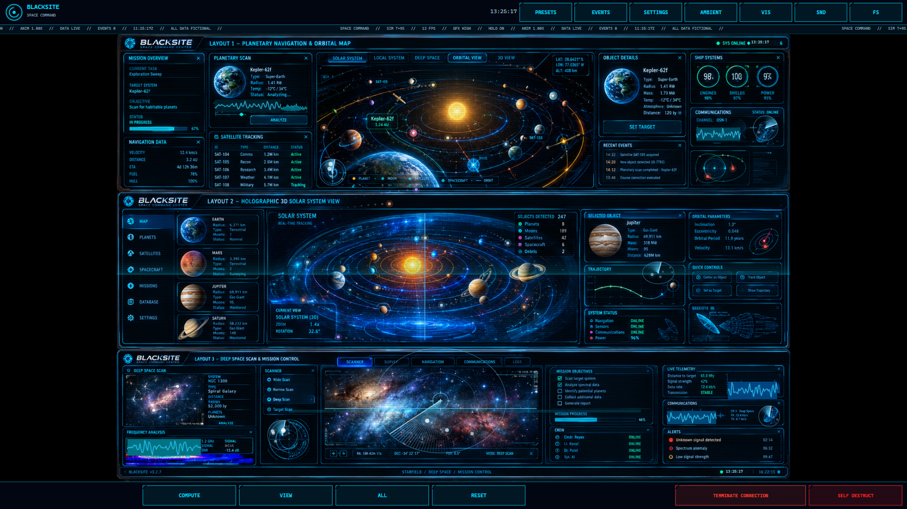
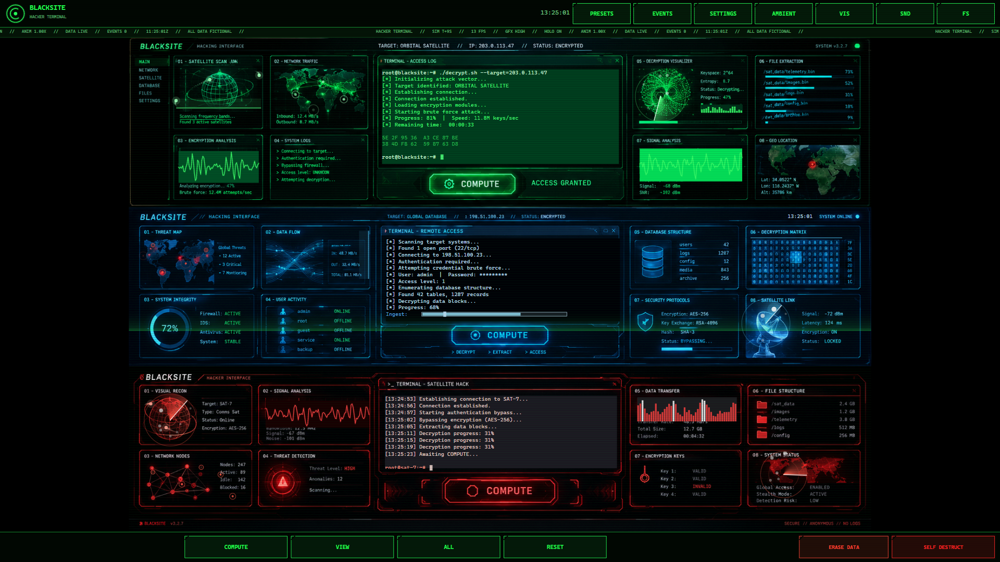
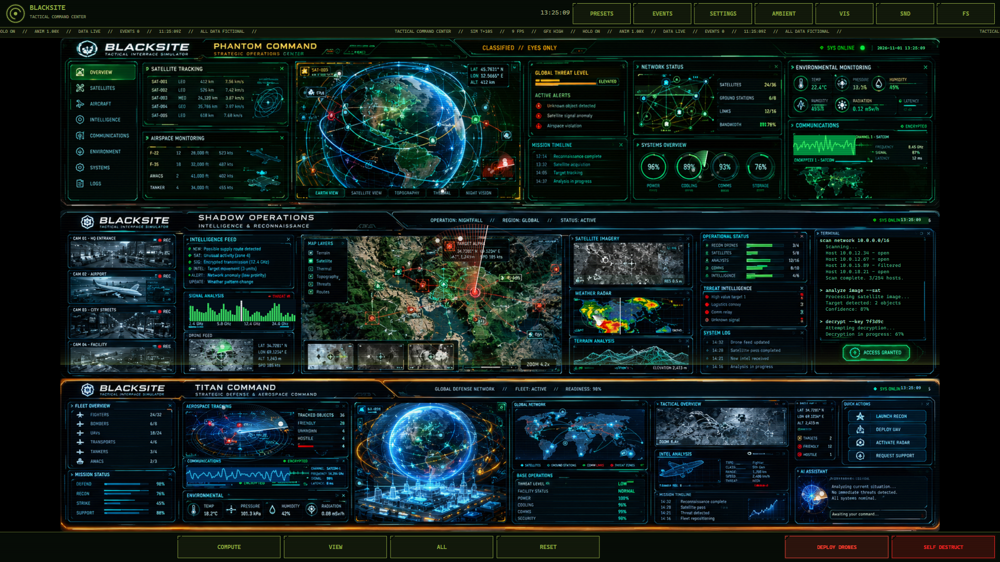
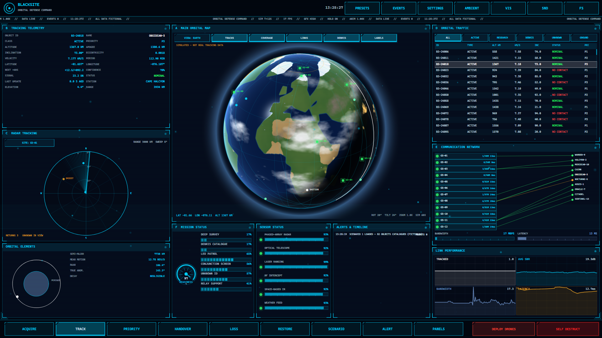
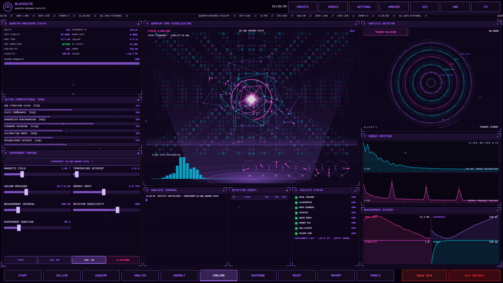
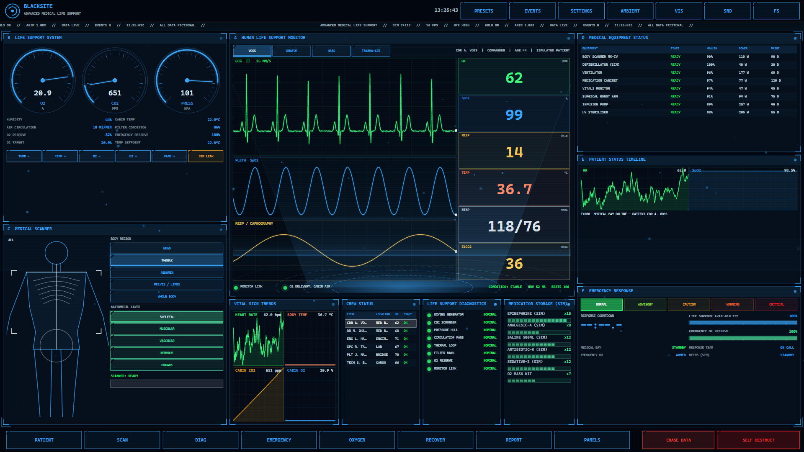
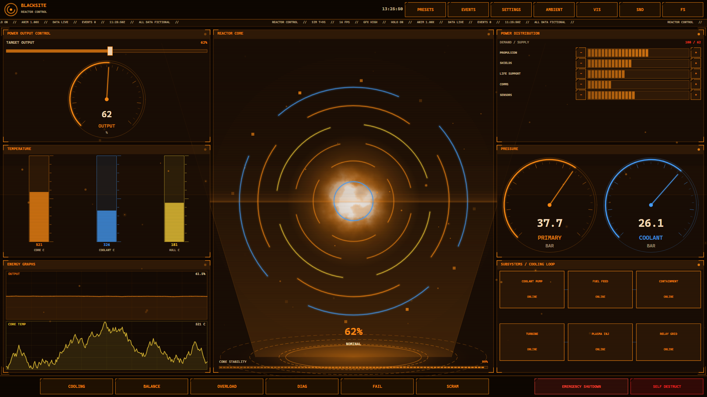
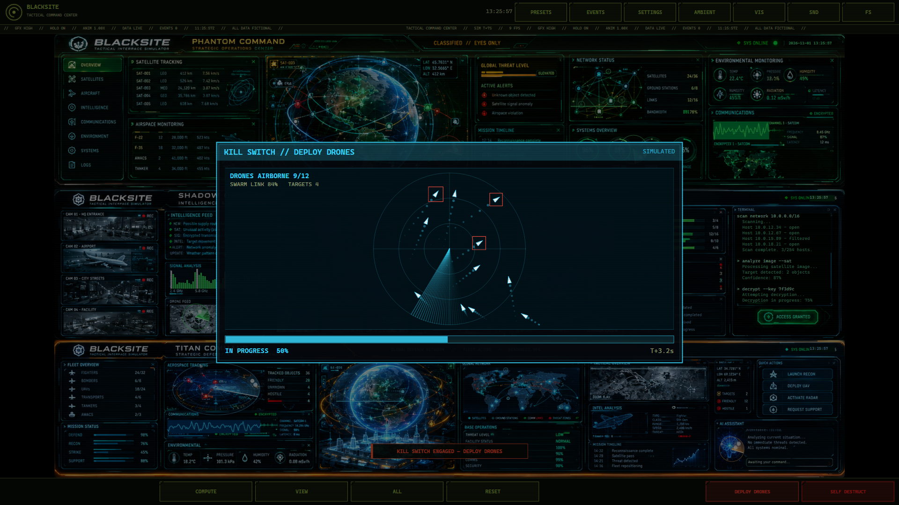
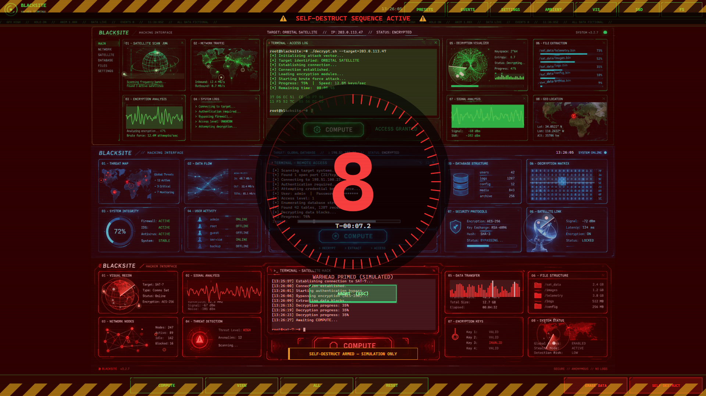

# BLACKSITE — Tactical Interface Simulator

Turns a Windows or Linux PC (ParrotOS, Debian, Ubuntu, Kali ...) or an Android tablet into a futuristic command-centre display: fifteen fully interactive sci-fi
interfaces, cinematic events, synthesised sound and voice, ambient/wall-display modes and multi-monitor setups.

> **Entertainment only.** Every reading, satellite, camera feed, network, threat, unit and mission in BLACKSITE is
> procedurally generated and fictional. It never scans a network, tracks real objects, accesses a camera or
> microphone, or changes any real security setting. Works fully offline; no accounts, no servers.

## Screenshots





| | |
|---|---|
|  |  |
|  |  |
|  |  |

Space Command, Hacker Terminal and Tactical Command Center are built on artwork-driven skins: the picture is the background
and live text, waveforms, radars, orbits, clocks and clickable buttons (COMPUTE, ACCESS) are drawn on top of it.

## Kill switch and self-destruct

Every preset has two red buttons at the right of the bottom bar:

* **Kill switch** – ERASE DATA, TERMINATE CONNECTION, DEPLOY DRONES or EMERGENCY SHUTDOWN, depending on the preset, with its own animation.
* **SELF DESTRUCT** – 10-second countdown (ABORT or Esc cancels), screen shake, detonation, then an automatic reboot.

Both are purely visual and audible; nothing on disk or in your settings is touched.

## The fifteen presets

| # | Preset | Highlights |
|---|--------|-----------|
| 1 | SPACE COMMAND | Rotating planets, orbit tracks, drag-to-rotate, zoom, satellite tracking, launch countdown |
| 2 | HACKER TERMINAL | Multi-window terminals, working fictional commands, network topology, hex streams, decrypt animation |
| 3 | SURVEILLANCE CONTROL | 4/6/9 procedural camera feeds, night vision, thermal, motion boxes, interference, fullscreen feed |
| 4 | JARVIS AI CORE | Holographic core, voice announcements, diagnostics, analysis, personalities |
| 5 | SYSTEM LOCKDOWN | Lockdown, countdown, biometric verification, keypad override, threat assessment |
| 6 | SATELLITE INTELLIGENCE | Offline globe + flat map, ground tracks, coverage, scan sweep, overlays |
| 7 | REACTOR CONTROL | Power slider, distribution, cooling, overload, subsystem failures, SCRAM |
| 8 | CYBER DEFENSE CENTER | Animated attack vectors, firewall, protocols, analysis, fictional reports, 3 views |
| 9 | DEEP SPACE EXPLORATION | Star chart, warp & hyperspace sequences, life support, objectives |
| 10 | TACTICAL COMMAND CENTER | Moving units, orders, objectives, radar detection, intel, layers |
| 11 | ORBITAL DEFENSE COMMAND | Lit Earth globe + 3D orbit view, Kepler-consistent orbits, radar sky plot, traffic table with filters, ground-station links, handover, signal loss, conjunction alerts |
| 12 | QUANTUM RESEARCH FACILITY | Quantum core, qubit state indicators, particle detector with field-curved tracks, 7 experiment controls that drive telemetry, spectra, analysis terminal, scientific report |
| 13 | DEEP SPACE COMMUNICATION ARRAY | Spectrum analyzer + scrolling waterfall, 8-dish telescope array, link-budget tracking, decoding terminal, channels, signal intelligence, the 9-step UNKNOWN TRANSMISSION event |
| 14 | ADVANCED MEDICAL LIFE SUPPORT | ECG/pleth/respiration monitor, cabin air that drives patient vitals, anatomical scanner, equipment, emergency response, recovery (all fictional) |
| 15 | UNDERGROUND FACILITY COMMAND | 8-level cross-section, security zones/checkpoints, cameras, power bus network with generators, infrastructure, personnel, incidents, FACILITY SECURITY BREACH event |

Presets 11–15 use a shared **panel deck**: 10–11 panels each, tap a panel title to expand it, **PANELS** button to show/hide/reorder panels, change accent colour, data-update speed, animation speed and alert frequency, and save/restore the layout (stored per preset).

## Install

### One line

**Linux** (ParrotOS, Debian, Ubuntu, Kali, Mint, Fedora, Arch; x86-64 and ARM64) - installs for your user only:

```bash
curl -fsSL https://raw.githubusercontent.com/unupunct/Blacksite/main/install-linux.sh | bash
```

Then start **BLACKSITE** from the application menu or run `blacksite` (`blacksite --fullscreen --preset hacker` to open a preset
full screen). Remove it with `... | bash -s -- --uninstall`. On Debian-based systems the script installs (with `sudo`, asking for your password) the few
system packages it needs (fontconfig, X11 libraries, `pulseaudio-utils` for sound, `espeak-ng` for voice). Sound is played
through `pacat` / `pw-cat` / `aplay`, whichever exists; without any of them the app runs silently.

**Windows 10 / 11** (PowerShell, no admin rights):

```powershell
irm https://raw.githubusercontent.com/unupunct/Blacksite/main/install-windows.ps1 | iex
```

### Manual downloads

Everything is on the [Releases](https://github.com/unupunct/Blacksite/releases) page.

**Linux** - `blacksite-linux-x64.tar.gz` / `blacksite-linux-arm64.tar.gz` (self-contained, no .NET needed; verify with `SHA256SUMS`).
Needs an X11 or XWayland desktop. Build it yourself with `python scripts/build-linux.py`.

**Windows 10 / 11 (x64)** — download from the [Releases](https://github.com/unupunct/Blacksite/releases) page (built into `output/windows/`)
* `BLACKSITE-Setup.exe` – per-user installer (no admin rights).
* `BLACKSITE-Portable.zip` – unzip anywhere; settings are kept in `Data\` next to the exe.
* `BLACKSITE.exe` – self-contained single file (no .NET install needed).
* `BLACKSITE-FrameworkDependent.zip` – small build; requires the .NET 10 Desktop Runtime.

**Android 8.0+ (API 26)** — `BLACKSITE-release.apk` on the Releases page (built into `output/android/`)
* `BLACKSITE-release.apk` (signed) or `BLACKSITE-debug.apk`. Enable *Install unknown apps* for your file manager,
  open the APK, install. Details: `Documentation/Android.md`.

## Controls

| Input | Action |
|-------|--------|
| F1–F10 / Ctrl+F1–F5 | Switch preset 1–10 / 11–15 | 
| F11 / Esc | Fullscreen / exit fullscreen or close overlay |
| F12 | Ambient (cinematic) mode |
| Space | Trigger the preset's primary action |
| M · H · D · P · E | Mute · HUD · diagnostics · preset manager · event panel |
| Ctrl+S | Settings |
| Right-click / long-press | Context menu / radial menu |
| Drag · wheel · pinch · double-tap · swipe | Preset specific; swipe left/right switches preset |

All shortcuts are rebindable under *Settings → Controls*.

## Build from source

Requirements: .NET 10 SDK. Android additionally needs JDK 17, the Android SDK (platform 36) and the `android`
workload. `scripts/` expects them in `.tools/` (see `Documentation/Developer.md`).

```powershell
scripts\build-windows.ps1     # exe, installer, portable zip, framework-dependent
scripts\build-android.ps1     # debug + release APK
dotnet test tests\Blacksite.Tests
```

## Documentation
`Documentation/Architecture.md` · `Developer.md` · `Customization.md` · `Android.md` · `Windows.md` · `AddingContent.md`
